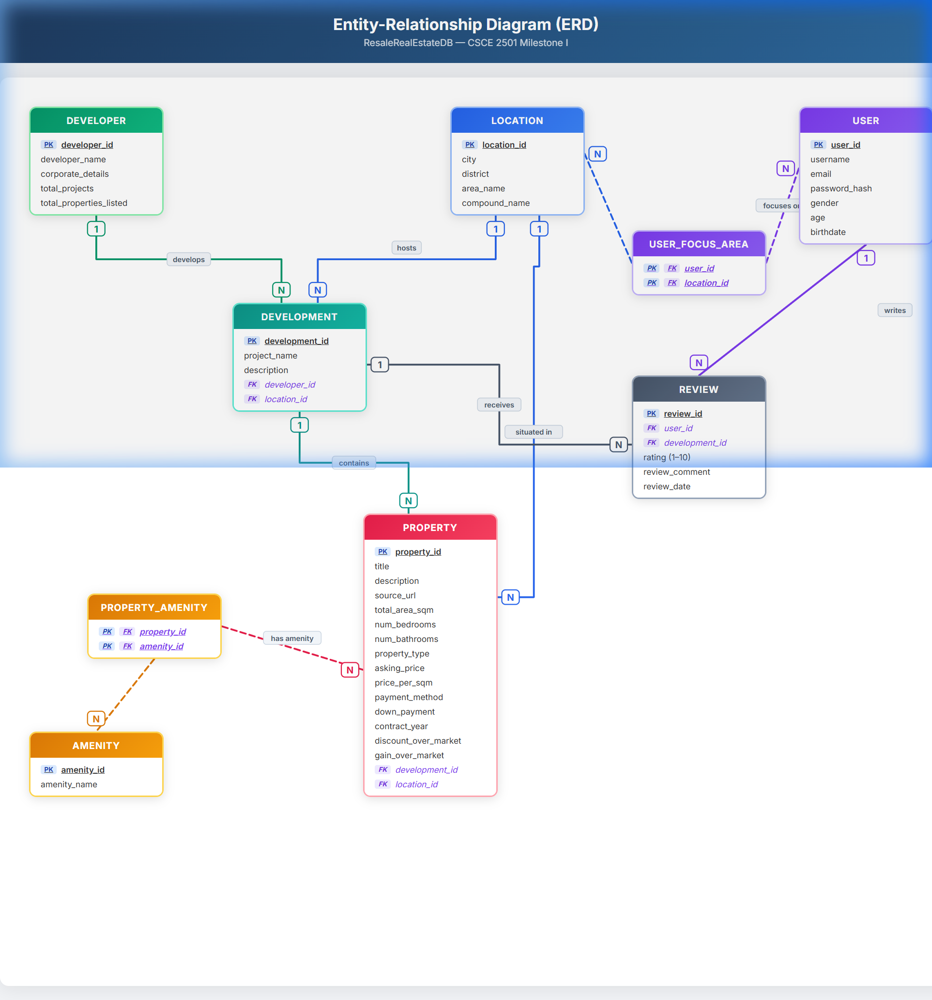

# CSCE 2501: Fundamentals of Database Systems — Project
## Resale Real Estate Database

---

### 📌 Project Overview
A robust relational database backend for a **Resale Properties in Egypt** platform, providing advanced filtering, market analytics, and high-level aggregation features that existing platforms lack.

---

## 📦 Milestone I: Database Design & Implementation

### Deliverables

| # | Deliverable | File |
|---|---|---|
| 1 | Entity-Relationship Diagram (ERD) | [`ERD.md`](ERD.md) / [`ERD_Diagram.html`](ERD_Diagram.html) |
| 2 | Relational Model (Schema Mapping) | [`Relational_Model.md`](Relational_Model.md) |
| 3 | MySQL Database Script | [`ResaleRealEstateDB.sql`](ResaleRealEstateDB.sql) |

---

## 🗂️ Entity-Relationship Diagram (ERD)

> Open [`ERD_Diagram.html`](ERD_Diagram.html) in a browser for the interactive version.

### Full ERD


---

## 🏗️ Database Schema Summary

| Table | Type | Relationships |
|---|---|---|
| **Location** | Independent | Referenced by Development, Property, User_Focus_Area |
| **Developer** | Independent | Referenced by Development |
| **User** | Independent | Referenced by Review, User_Focus_Area |
| **Amenity** | Independent (Lookup) | Referenced by Property_Amenity |
| **Development** | Dependent | FK → Developer, Location |
| **Property** | Dependent | FK → Development, Location |
| **Property_Amenity** | Junction (M:N) | FK → Property, Amenity |
| **User_Focus_Area** | Junction (M:N) | FK → User, Location |
| **Review** | Dependent | FK → User, Development |

---

## 🔗 Relationships & Cardinalities

| Relationship | Cardinality | Description |
|---|---|---|
| Developer → Development | **1 : N** | A developer develops many development projects |
| Location → Development | **1 : N** | A location hosts many developments |
| Development → Property | **1 : N** | A development contains many properties |
| Location → Property | **1 : N** | A location has many properties situated in it |
| Property ↔ Amenity | **M : N** | Via `Property_Amenity` junction table |
| User → Review | **1 : N** | A user writes many reviews |
| Development → Review | **1 : N** | A development receives many reviews |
| User ↔ Location | **M : N** | Via `User_Focus_Area` junction table |

---

## ⚙️ How to Run

1. Open **MySQL Workbench** (or any MySQL client)
2. Connect to your MySQL server
3. Open `ResaleRealEstateDB.sql`
4. Execute the entire script (⚡ button in Workbench)
5. All 9 tables will be created in the `ResaleRealEstateDB` database

```sql
-- Quick verification after running:
USE ResaleRealEstateDB;
SHOW TABLES;
```

---

## 🧪 Normalization

| Normal Form | Status |
|---|---|
| **1NF** | ✅ All attributes are atomic; multi-valued attributes resolved via junction tables |
| **2NF** | ✅ No partial dependencies |
| **3NF** | ✅ No transitive dependencies |
| **BCNF** | ✅ Every determinant is a candidate key |

---

## 👥 Team

CSCE 2501 — Fall 2026