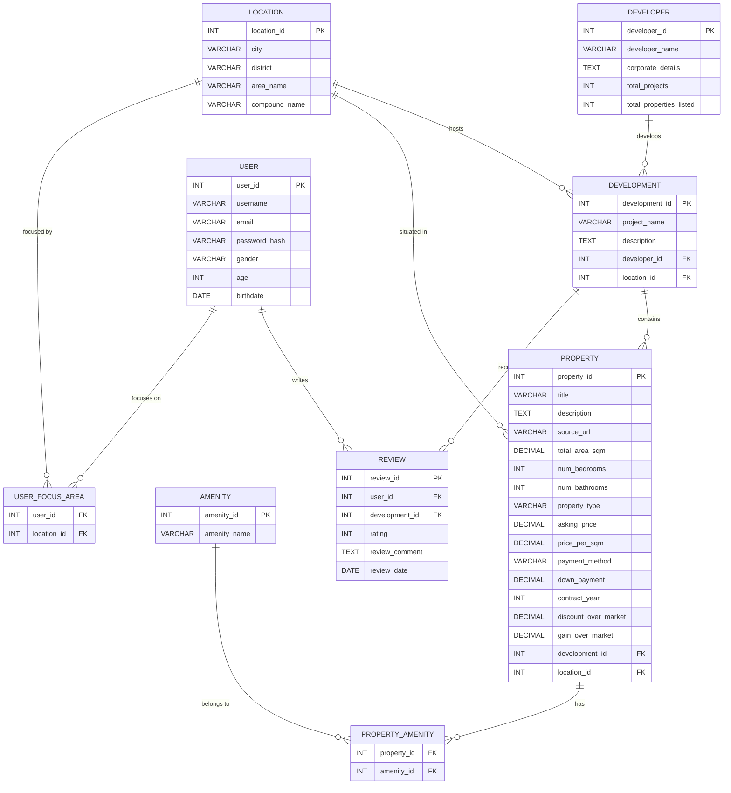

# Entity-Relationship Diagram (ERD)
## Resale Real Estate Database — CSCE 2501 Milestone I

---

> **Interactive Visualization:** Open [ERD_Diagram.html](ERD_Diagram.html) in any browser for an interactive SVG view.  
> **Visual Screenshot:** See the high-resolution rendering below ([screenshots/erd_full.png](screenshots/erd_full.png)).

---

### Mermaid ERD Specification

---

## Entities & Attributes Summary

### 1. LOCATION
| Attribute | Type | Constraint |
|---|---|---|
| **location_id** | INT | PRIMARY KEY |
| city | VARCHAR(100) | NOT NULL |
| district | VARCHAR(100) | |
| area_name | VARCHAR(100) | |
| compound_name | VARCHAR(150) | |

### 2. DEVELOPER
| Attribute | Type | Constraint |
|---|---|---|
| **developer_id** | INT | PRIMARY KEY |
| developer_name | VARCHAR(150) | NOT NULL, UNIQUE |
| corporate_details | TEXT | |
| total_projects | INT | DEFAULT 0 |
| total_properties_listed | INT | DEFAULT 0 |

### 3. DEVELOPMENT
| Attribute | Type | Constraint |
|---|---|---|
| **development_id** | INT | PRIMARY KEY |
| project_name | VARCHAR(200) | NOT NULL |
| description | TEXT | |
| *developer_id* | INT | FOREIGN KEY → DEVELOPER |
| *location_id* | INT | FOREIGN KEY → LOCATION |

### 4. PROPERTY
| Attribute | Type | Constraint |
|---|---|---|
| **property_id** | INT | PRIMARY KEY |
| title | VARCHAR(255) | NOT NULL |
| description | TEXT | |
| source_url | VARCHAR(500) | |
| total_area_sqm | DECIMAL(10,2) | |
| num_bedrooms | INT | |
| num_bathrooms | INT | |
| property_type | VARCHAR(50) | CHECK constraint |
| asking_price | DECIMAL(12,2) | |
| price_per_sqm | DECIMAL(10,2) | |
| payment_method | VARCHAR(20) | CHECK constraint |
| down_payment | DECIMAL(12,2) | |
| contract_year | INT | |
| discount_over_market | DECIMAL(5,2) | |
| gain_over_market | DECIMAL(5,2) | |
| *development_id* | INT | FOREIGN KEY → DEVELOPMENT |
| *location_id* | INT | FOREIGN KEY → LOCATION |

### 5. AMENITY
| Attribute | Type | Constraint |
|---|---|---|
| **amenity_id** | INT | PRIMARY KEY |
| amenity_name | VARCHAR(100) | NOT NULL, UNIQUE |

### 6. PROPERTY_AMENITY (Junction Table — M:N)
| Attribute | Type | Constraint |
|---|---|---|
| *property_id* | INT | FK → PROPERTY, part of COMPOSITE PK |
| *amenity_id* | INT | FK → AMENITY, part of COMPOSITE PK |

### 7. USER
| Attribute | Type | Constraint |
|---|---|---|
| **user_id** | INT | PRIMARY KEY |
| username | VARCHAR(50) | NOT NULL, UNIQUE |
| email | VARCHAR(100) | NOT NULL, UNIQUE |
| password_hash | VARCHAR(255) | NOT NULL |
| gender | VARCHAR(10) | CHECK constraint |
| age | INT | |
| birthdate | DATE | |

### 8. USER_FOCUS_AREA (Junction Table — M:N)
| Attribute | Type | Constraint |
|---|---|---|
| *user_id* | INT | FK → USER, part of COMPOSITE PK |
| *location_id* | INT | FK → LOCATION, part of COMPOSITE PK |

### 9. REVIEW
| Attribute | Type | Constraint |
|---|---|---|
| **review_id** | INT | PRIMARY KEY |
| *user_id* | INT | FOREIGN KEY → USER |
| *development_id* | INT | FOREIGN KEY → DEVELOPMENT |
| rating | INT | CHECK (1–10) |
| review_comment | TEXT | |
| review_date | DATE | NOT NULL |

---

## Relationship Summary

| Relationship | Cardinality | Participation |
|---|---|---|
| Developer → Development | 1:N | Total (Dev must have ≥1 development) / Partial |
| Location → Development | 1:N | Partial / Total |
| Development → Property | 1:N | Partial / Total |
| Location → Property | 1:N | Partial / Total |
| Property ↔ Amenity | M:N | Partial / Partial (via PROPERTY_AMENITY) |
| User → Review | 1:N | Partial / Total |
| Development → Review | 1:N | Partial / Total |
| User ↔ Location (Focus) | M:N | Partial / Partial (via USER_FOCUS_AREA) |
